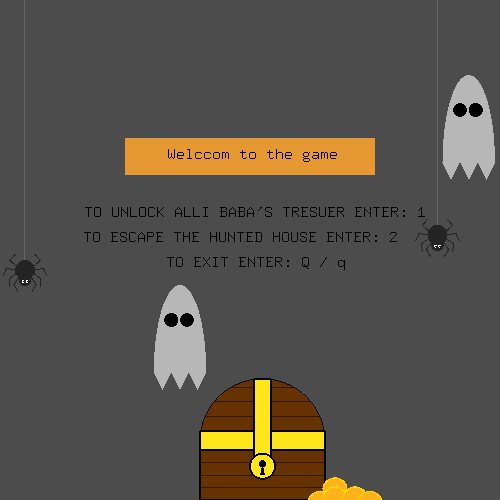
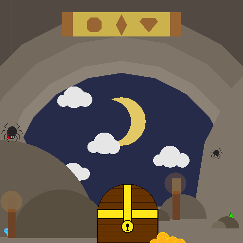
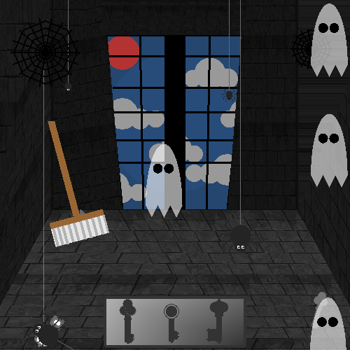

# Searching Adventure Game – Ali Baba's Treasure & The Haunted House

> A 2D point-and-click search game in C++ and OpenGL/GLUT. Find the three hidden gems in Ali Baba's cave, or the three keys to escape the haunted house.



## Overview

A computer-graphics course project that draws everything (cave, haunted room, ghosts, spiders, gems and keys) with OpenGL primitives such as triangles, quads, triangle-fan circles and transformations. The haunted house walls and floor use a BMP texture.

From the start menu the player picks one of two maps:

| Key | Map | Goal |
|---|---|---|
| `1` | **Ali Baba's Treasure** | Click the 3 hidden gems before the pirates do |
| `2` | **The Haunted House** | Click the 3 hidden keys and escape |
| `Q` / `q` | – | Quit |

Each item you find lights up in the inventory bar at the top or bottom of the screen. When all three are found, a win message appears, for example *"YOU FOUND ALL THE KEYS!! HURRY UP AND ESCAPE!!"*.

## Features

- Two hand-drawn scenes built from OpenGL 2D primitives
- Animated ghosts and dangling spiders (idle-callback animation)
- Mouse hit-testing to collect hidden gems and keys
- An inventory bar that fills in as items are found, plus win messages
- A BMP texture for the haunted house walls and floor (`assets/floor-texture.bmp`)
- One cross-platform source file: macOS (GLUT framework) and Linux/Windows (freeglut + GLEW)

## Screenshots

| Ali Baba's Treasure | The Haunted House |
|---|---|
|  |  |

## Tech Stack

- **C++**
- **OpenGL** (fixed-function pipeline) + **GLUT** / **freeglut**
- Xcode project for macOS. A `Makefile` for Linux and macOS is included.

## How to Run

> Run the game from the **repository root** so it finds `assets/floor-texture.bmp`. It also tries `../assets/` and `../../assets/`.

### Linux
```bash
sudo apt install g++ make freeglut3-dev libglew-dev
make run
```

### macOS (Xcode)
1. Open `CG-Project.xcodeproj` in Xcode.
2. Go to *Product → Scheme → Edit Scheme → Run → Options*, enable **Use custom working directory** and set it to the repository folder (`$(PROJECT_DIR)`).
3. Build and run (⌘R).

Or from the terminal: `make run`. It links the OpenGL and GLUT frameworks.

### Windows
Build `CG-Project/main.cpp` with freeglut and GLEW (for example MSYS2/MinGW: `g++ CG-Project/main.cpp -lfreeglut -lglew32 -lglu32 -lopengl32`), then run it from the repository root.

## Project Structure

```
Searching-Advancer-Game-/
├── CG-Project/
│   └── main.cpp              # entire game: scenes, objects, input, texture loading
├── CG-Project.xcodeproj/     # Xcode project (macOS)
├── assets/
│   └── floor-texture.bmp     # 626×626 texture for walls/floor
├── docs/screenshots/
├── Makefile
└── LICENSE
```

## Notes

- The texture loader reads the BMP's raw bytes as 626×626 RGB, without parsing the BMP header, so replacement textures must have the same size and format.
- Gem and key hit-boxes are in window pixels for the default 500×500 window.

## Credits

Team project for a Computer Graphics course (the window title credits the team as *"The Computer Geeks"*).
Built by **Hala Jalal** and teammates as a university project at Umm Al-Qura University.

## License

[MIT](LICENSE) © 2025 Hala Jalal
